<div align="center">

# TechStore | loja_tech

**Consultas SQL, Stored Procedures e Views em MySQL**


*Atividade individual de Banco de Dados com o e-commerce fictício **TechStore**.*

</div>

---

## Índice

- [Sobre o projeto](#sobre-o-projeto)
- [Objetivos de aprendizagem](#objetivos-de-aprendizagem)
- [Estrutura do repositório](#estrutura-do-repositório)
- [Modelo de dados](#modelo-de-dados)
- [Como executar](#como-executar)
- [Parte 1: Consultas SQL](#parte-1-consultas-sql)
- [Parte 2: Stored Procedures](#parte-2-stored-procedures)
- [Parte 3: Views vs Stored Procedures](#parte-3-views-vs-stored-procedures)
- [Evidências de execução](#evidências-de-execução)
- [Boas práticas aplicadas](#boas-práticas-aplicadas)
- [Referências](#referências)
- [Autor](#autor)

---

## Sobre o projeto

A **TechStore** é uma loja de tecnologia que vende notebooks, smartphones, periféricos, monitores e armazenamento. O banco `loja_tech` guarda categorias, produtos, clientes, pedidos, itens de cada pedido e um log de auditoria.

Este repositório reúne a resolução completa da atividade:

| Parte | Entrega | Quantidade |
|:-----:|---------|:----------:|
| 1 | Consultas SQL (nível muito fácil) | **10** |
| 2 | Stored Procedures | **5** |
| 3 | Exemplos de uso de Views no lugar de Procedures | **5** |

## Objetivos de aprendizagem

- Praticar a sintaxe básica de `SELECT`, `WHERE`, `ORDER BY`, `LIKE`, `COUNT`, `SUM` e `INNER JOIN`.
- Criar procedures com parâmetros `IN` e `OUT`, `INSERT` e `UPDATE`.
- Entender **quando usar View e quando usar Stored Procedure**.
- Organizar e documentar um projeto de banco de dados em um repositório.

## Estrutura do repositório

```text
loja_tech_banco/
├── prints/                      # evidências de execução no MySQL Workbench
├── loja_tech_schema.txt         # criação do banco e das tabelas
├── loja_tech_dump.sql           # schema + carga inicial (importável)
├── loja_tech_consultas.txt      # 10 desafios de consultas SQL
├── loja_tech_procedures.txt     # 5 stored procedures
├── loja_tech_views.txt          # 5 exemplos: views vs stored procedures
└── README.md
```

## Modelo de dados

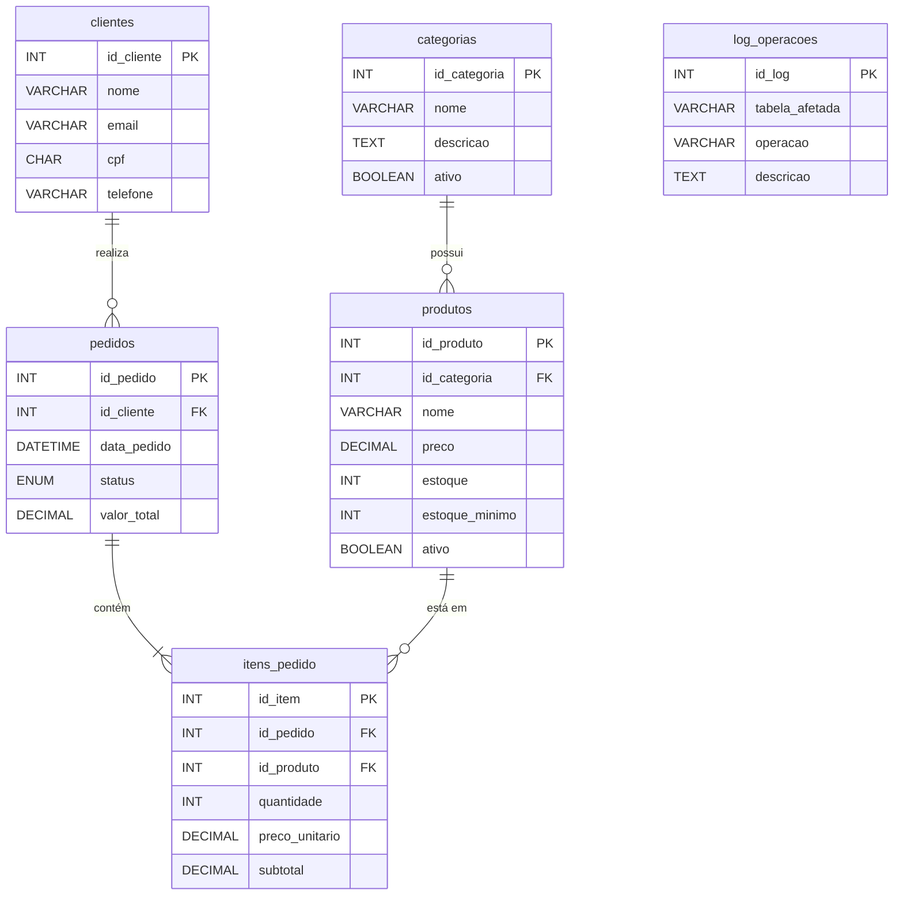

**Relacionamentos:** uma categoria tem vários produtos; um cliente faz vários pedidos; um pedido tem um ou mais itens; um produto pode aparecer em vários itens.

## Como executar

**Pré-requisitos:** MySQL 8.0+ e MySQL Workbench.

1. Clone o repositório:
   ```bash
   git clone https://github.com/nohanaassis-ui/loja_tech_banco.git
   ```
2. No Workbench, abra e execute `loja_tech_dump.sql`. Ele cria o banco `loja_tech` e carrega os dados iniciais.
3. Selecione o banco:
   ```sql
   USE loja_tech;
   ```
4. Abra `loja_tech_consultas.txt`, `loja_tech_procedures.txt` e `loja_tech_views.txt` e execute por blocos (`Ctrl + Enter`).

> Via terminal: `mysql -u root -p < loja_tech_dump.sql`

## Parte 1: Consultas SQL

Arquivo: [`loja_tech_consultas.txt`](./loja_tech_consultas.txt)

| # | Desafio | Conceito |
|:-:|---------|----------|
| 1 | Nome e e-mail de todos os clientes | `SELECT` |
| 2 | Produtos abaixo de R$ 500,00 | `WHERE` |
| 3 | Pedidos com status `pendente` | `WHERE` com ENUM |
| 4 | Produtos do mais caro ao mais barato | `ORDER BY DESC` |
| 5 | Produtos que contêm "Monitor" | `LIKE '%Monitor%'` |
| 6 | Periféricos com mais de 40 unidades | `AND` |
| 7 | Total de clientes (`total_clientes`) | `COUNT` + alias |
| 8 | Faturamento bruto (`faturamento_bruto`) | `SUM` + alias |
| 9 | Produto com o nome da categoria | `INNER JOIN` |
| 10 | Pedidos da cliente Ana Silva | `INNER JOIN` + filtro |

Exemplo (desafio 10):

```sql
SELECT pe.id_pedido, pe.status, pe.valor_total
FROM pedidos pe
INNER JOIN clientes c ON c.id_cliente = pe.id_cliente
WHERE c.nome = 'Ana Silva';
```

## Parte 2: Stored Procedures

Arquivo: [`loja_tech_procedures.txt`](./loja_tech_procedures.txt)

| Procedure | Parâmetros | O que faz |
|-----------|-----------|-----------|
| `listar_categorias_ativas` | nenhum | Lista categorias ativas em ordem alfabética |
| `buscar_pedidos_por_status` | `IN p_status` | Retorna pedidos com o status informado |
| `inserir_categoria` | `IN p_nome`, `IN p_descricao` | Insere uma nova categoria |
| `atualizar_telefone_cliente` | `IN p_id_cliente`, `IN p_telefone` | Atualiza o telefone do cliente |
| `contar_produtos_categoria` | `IN p_id_categoria`, `OUT p_total` | Devolve a quantidade de produtos da categoria |

Exemplo com parâmetro de saída:

```sql
DROP PROCEDURE IF EXISTS contar_produtos_categoria;
DELIMITER //
CREATE PROCEDURE contar_produtos_categoria(
    IN  p_id_categoria INT,
    OUT p_total INT
)
BEGIN
    SELECT COUNT(*) INTO p_total
    FROM produtos
    WHERE id_categoria = p_id_categoria;
END //
DELIMITER ;

CALL contar_produtos_categoria(3, @total);
SELECT @total AS total_produtos;
```

## Parte 3: Views vs Stored Procedures

Arquivo: [`loja_tech_views.txt`](./loja_tech_views.txt)

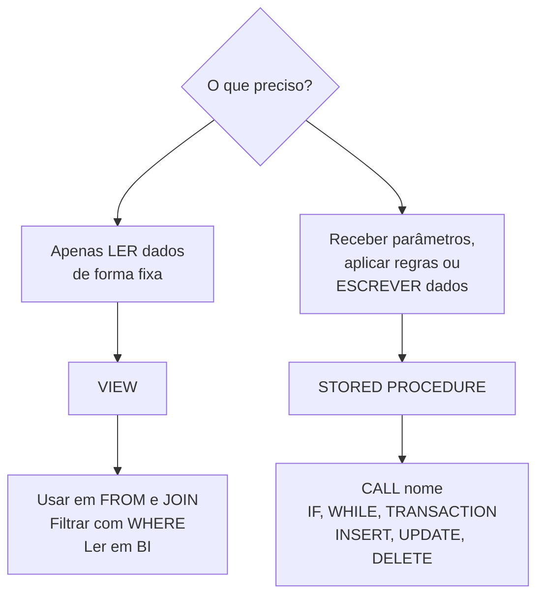

### Cinco situações em que a View é a melhor escolha

| # | View | Situação | Por que View e não Procedure? |
|:-:|------|----------|-------------------------------|
| 1 | `vw_catalogo_produtos` | Vitrine com produto, categoria, preço e estoque | Consulta fixa e reutilizável, que pode ser filtrada com `WHERE` depois |
| 2 | `vw_pedidos_clientes` | Painel do atendimento com pedido e nome do cliente | Só leitura; esconde o `JOIN` e simplifica a consulta |
| 3 | `vw_estoque_baixo` | Alerta de reposição para a logística | Funciona como tabela virtual sempre atualizada |
| 4 | `vw_resumo_cliente` | Total de pedidos e valor gasto por cliente em dashboards | Ferramentas de BI leem views como tabelas; um `CALL` não entra em `FROM` ou `JOIN` |
| 5 | `vw_clientes_publico` | Perfil restrito que não pode ver CPF e telefone | Expõe só colunas permitidas, ajudando na proteção de dados (LGPD) |

### Comparativo rápido

| Característica | View | Stored Procedure |
|----------------|:----:|:----------------:|
| Aceita parâmetros | Não | Sim (`IN`, `OUT`, `INOUT`) |
| Pode ser usada em `SELECT ... FROM` | Sim | Não |
| Executa `INSERT`, `UPDATE` e `DELETE` | Limitado | Sim |
| Suporta `IF`, `WHILE` e transações | Não | Sim |
| Chamada | `SELECT * FROM vw_x` | `CALL proc()` |
| Melhor uso | Leitura e relatórios fixos | Regras de negócio e operações |

## Evidências de execução

Os prints do MySQL Workbench estão na pasta [`prints/`](./prints).

## Evidências de execução

Prints da execução no MySQL Workbench. Todos os arquivos ficam na pasta [`prints/`](./prints).

### Parte 1: Consultas SQL

**1. Listagem de clientes**

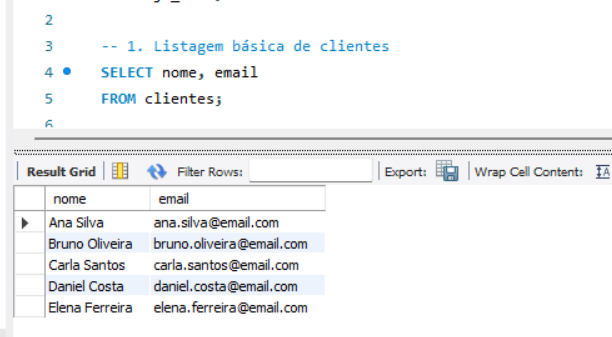

**2. Produtos abaixo de R$ 500,00**

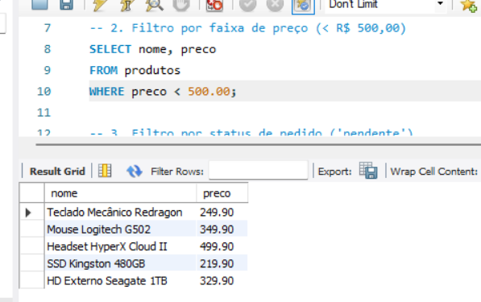

**3. Pedidos pendentes**

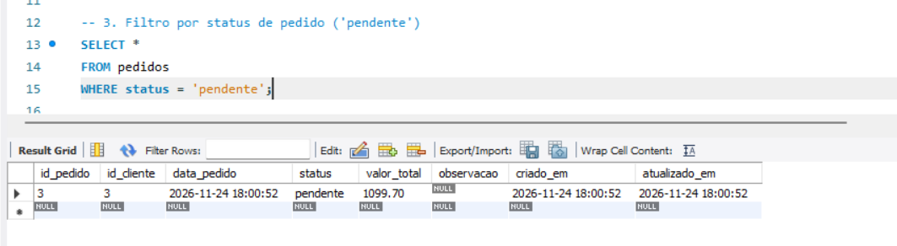

**4. Catálogo ordenado por preço**

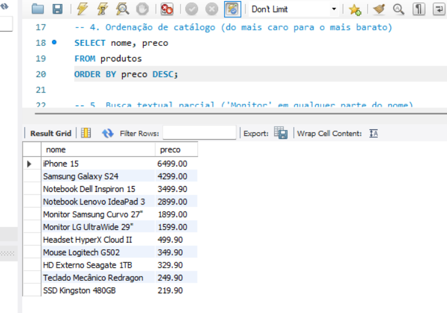

**5. Busca por "Monitor"**

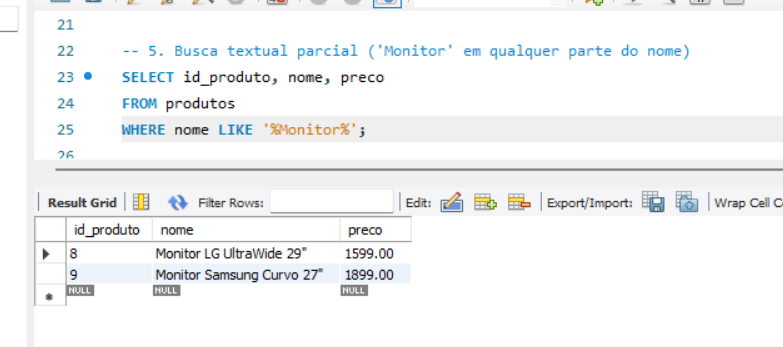

**6. Periféricos com estoque acima de 40**

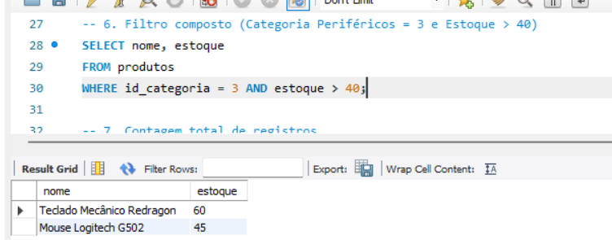

**7. Total de clientes**

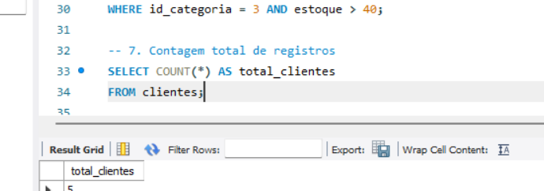

**8. Faturamento bruto**

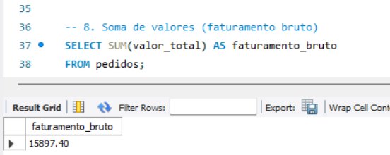

**9. Produto com categoria (INNER JOIN)**

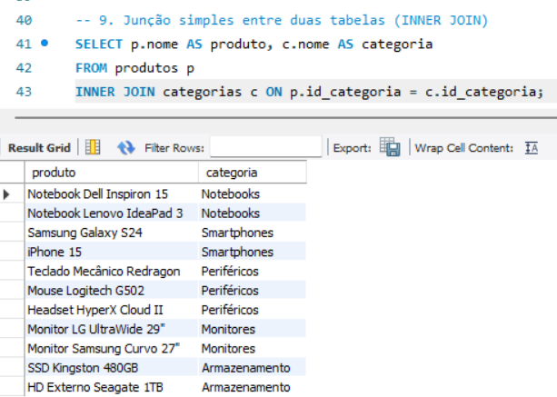

**10. Pedidos da cliente Ana Silva**

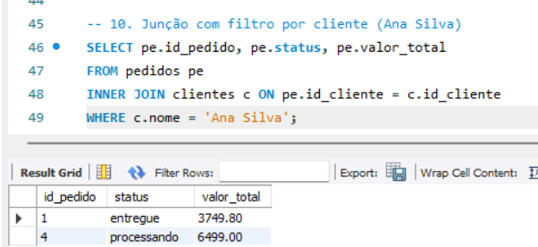

### Parte 2: Stored Procedures

**1. `listar_categorias_ativas`**

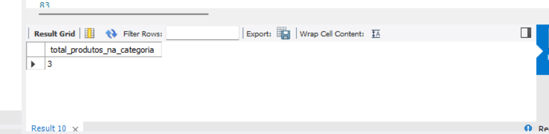

**2. `buscar_pedidos_por_status`**

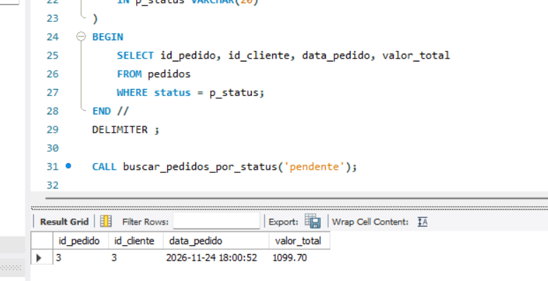

**3. `inserir_categoria`**

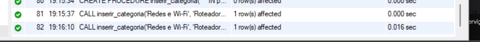

**4. `atualizar_telefone_cliente`**


**5. `contar_produtos_categoria`**

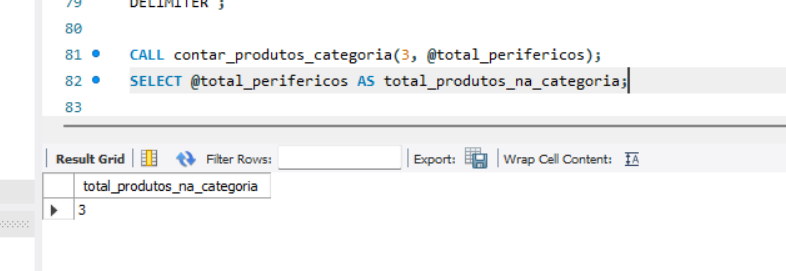

**Avançadas (atividade da aula)**

**`atualizar_preco_categoria`**

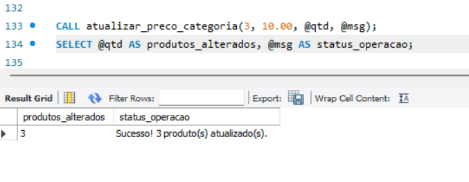

**`consultar_extrato_cliente`**

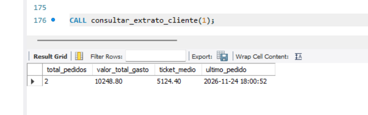

### Parte 3: Views

**Catálogo / vitrine**

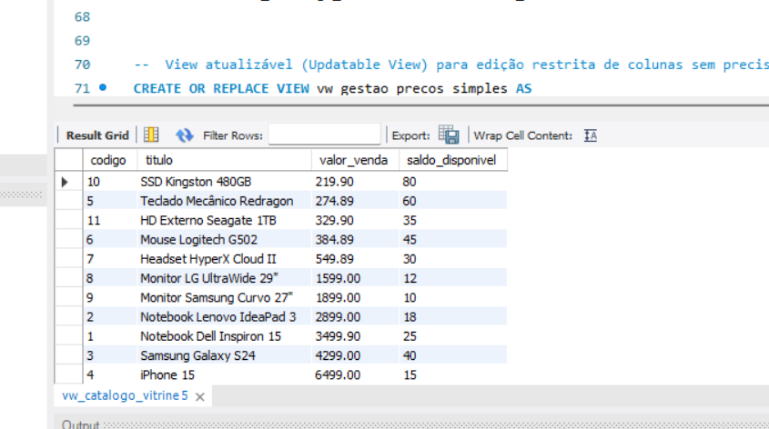

**Clientes (visão pública)**

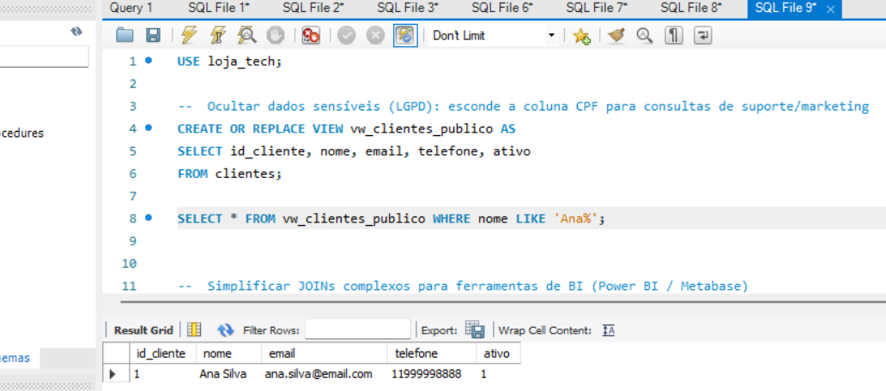

**Detalhes dos itens do pedido**

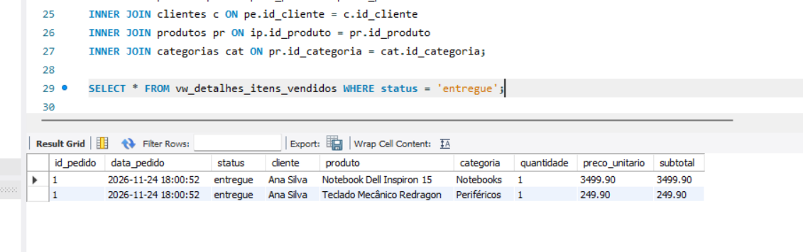

## Boas práticas aplicadas

- `DROP PROCEDURE IF EXISTS` antes de cada `CREATE PROCEDURE`
- `DELIMITER //` para criar as procedures
- Prefixo `p_` em todos os parâmetros
- Nomes descritivos (verbo + substantivo)
- Colunas listadas explicitamente, sem `SELECT *` dentro de procedures
- Comentários explicando cada bloco

## Referências

- Material de aula: *Stored Procedures no MySQL* (`aula-stored-procedures.pdf`)
- [MySQL 8.0 Reference Manual: Stored Routines](https://dev.mysql.com/doc/refman/8.0/en/stored-routines.html)
- [MySQL 8.0 Reference Manual: CREATE VIEW](https://dev.mysql.com/doc/refman/8.0/en/create-view.html)
- [GitHub Docs: Creating diagrams with Mermaid](https://docs.github.com/en/get-started/writing-on-github/working-with-advanced-formatting/creating-diagrams)

## Autor

**Nohana Assis**
Disciplina de Banco de Dados
GitHub: [@nohanaassis-ui](https://github.com/nohanaassis-ui)

---

<div align="center">

Feito com muito SELECT e um pouco de café.

</div>
